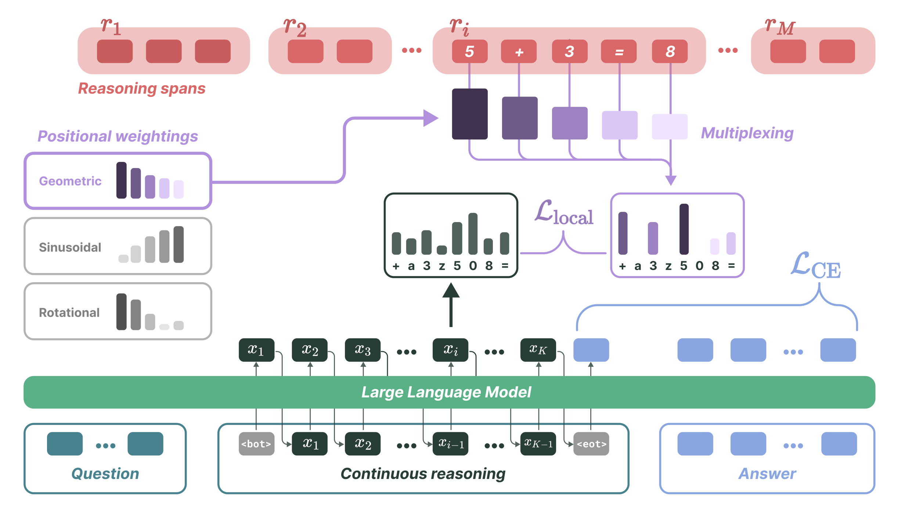

<div align="center">

# MUX: Continuous Reasoning via Multiplexed Tokens

**[Ayhan Suleymanzade](https://misakitaro0414.github.io/)**<sup>1</sup> &nbsp;&nbsp; **[Halil Alperen Gozeten](https://github.com/alperengozeten)**<sup>2</sup> &nbsp;&nbsp; **[Michael Bronstein](https://www.cs.ox.ac.uk/people/michael.bronstein/)**<sup>3,1</sup> &nbsp;&nbsp; **[İsmail İlkan Ceylan](https://informatics.tuwien.ac.at/people/ismail-ceylan)**<sup>4,1,3,&dagger;</sup> &nbsp;&nbsp; **[Jinwoo Kim](https://jw9730.github.io/)**<sup>5,&dagger;</sup>

<sup>1</sup>AITHYRA &nbsp;&nbsp; <sup>2</sup>University of Michigan &nbsp;&nbsp; <sup>3</sup>University of Oxford &nbsp;&nbsp; <sup>4</sup>TU Wien &nbsp;&nbsp; <sup>5</sup>KAIST &nbsp;&nbsp; <sup>&dagger;</sup>Equal advising

[](https://misakitaro0414.github.io/mux/)
[](LICENSE)
[](https://www.python.org/)
[](https://huggingface.co/MisakiTaro0414/MUX)



</div>

## TL;DR

**MUX** compresses discrete chain-of-thought reasoning into continuous *multiplexed tokens*. Each latent token is trained to represent a **weighted linear superposition** of a span of discrete reasoning subwords via KL-divergence distillation. The superposition is lossless by construction.

## Setup

```bash
git clone https://github.com/MisakiTaro0414/MUX.git
cd MUX
conda create --name mux python=3.12
conda activate mux
pip install -r requirements.txt
```

## Pretrained Checkpoints

| Model | Dataset | HF Link |
|:---|:---|:---|
| GPT-2 + MUX | GSM8K-AUG | [MisakiTaro0414/MUX](https://huggingface.co/MisakiTaro0414/MUX/blob/main/mux-gpt2-gsm8k.bin) |
| LLaMA 3.2 1B + MUX | GSM8K-AUG | [MisakiTaro0414/MUX](https://huggingface.co/MisakiTaro0414/MUX/blob/main/mux-llama1b-gsm8k.bin) |

## Evaluation

```bash
# GSM8K
CKPT_DIR=/path/to/checkpoint bash scripts/eval_llama1b.sh
CKPT_DIR=/path/to/checkpoint bash scripts/eval_gpt2.sh

# Out-of-distribution (SVAMP, GSM-Hard, MultiArith)
DATA_NAME=svamp     CKPT_DIR=/path/to/checkpoint bash scripts/eval_llama1b.sh
DATA_NAME=gsm-hard  CKPT_DIR=/path/to/checkpoint bash scripts/eval_llama1b.sh
DATA_NAME=multi-arith CKPT_DIR=/path/to/checkpoint bash scripts/eval_llama1b.sh
```

## Training

### Mathematical Reasoning (GSM8K-AUG)
```bash
bash scripts/train_gpt2_gsm8k_aug.sh         # GPT-2
bash scripts/train_llama1b_gsm8k_aug.sh       # LLaMA 3.2 1B-Instruct
bash scripts/train_llama3b_gsm8k_aug.sh       # LLaMA 3.2 3B
bash scripts/train_llama8b_gsm8k_aug.sh       # LLaMA 3.1 8B
```

### Mathematical Reasoning (GSM8K-AUG-NL)
```bash
bash scripts/train_gpt2_gsm8k_aug_nl.sh       # GPT-2
bash scripts/train_llama1b_gsm8k_aug_nl.sh     # LLaMA 3.2 1B-Instruct
```

## Parallel Decoding (PCCoT)

For parallel latent token generation via Jacobi iterations (**MUX*** in the paper), see [`PCCOT/`](PCCOT/):
```bash
cd PCCOT
bash scripts/run_llama_ccot_superpose_kl.sh
```

## Interpreting Latent Thoughts

Probe and visualize what latent tokens encode:
```bash
CKPT_DIR=/path/to/checkpoint bash scripts/probe_latent_token.sh
```

## Key Arguments

| Argument | Description | Default |
|:---|:---|:---:|
| `ccot_superpose_kl` | Enable MUX superpose-KL training | `False` |
| `ccot_superpose_kl_scalar_positional_mode` | Weighting scheme: `geometric`, `sinusoidal`, `rope` | `geometric` |
| `ccot_superpose_kl_scalar_positional_decay` | Decay base for geometric weights | `0.9` |
| `ccot_superpose_random_chunk_to_latents` | Randomized chunking of CoT steps | `False` |
| `ccot_superpose_beta` | Weight for local superpose-KL loss | `1.0` |
| `num_latent` | Number of latent reasoning tokens | `5` |
| `inf_latent_iterations` | Latent iterations at inference | `1` |
| `use_prj` | Use projection layer for latent generation | `False` |
| `prj_dim` | Hidden dimension of projection layer | `2048` |

> **Note:** The current codebase does not support multi-GPU or multi-node training.

## Citation

```bibtex
@misc{suleymanzade2026mux,
  author    = {Suleymanzade, Ayhan and Gozeten, Halil Alperen and Bronstein, Michael and Ceylan, \.{I}smail \.{I}lkan and Kim, Jinwoo},
  title     = {{MUX}: Continuous Reasoning via Multiplexed Tokens},
  year      = {2026},
}
```

## Acknowledgments

Built upon [CODI](https://github.com/zhenyi4/CODI) (Shen et al., 2025). We thank the CODI authors for releasing their code.
